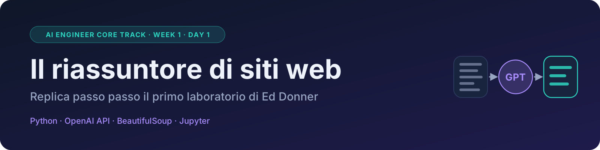

# LLM-Scraper

I miei esercizi del corso **AI Engineer Core Track** (LLM Engineering di Ed Donner).

## Week 1

| File | Cosa contiene |
| --- | --- |
| [week1/day1.ipynb](week1/day1.ipynb) | Guida illustrata per replicare il laboratorio Day 1: un riassuntore di siti web con GPT |
| [week1/day1_email_subjects.ipynb](week1/day1_email_subjects.ipynb) | La mia soluzione all'esercizio di Ed: incolli un'email e GPT propone 3 oggetti e un riassunto |
| [week1/day1_aviatrix.ipynb](week1/day1_aviatrix.ipynb) | Riassunto strutturato della documentazione di [docs.aviatrix.com](https://docs.aviatrix.com/), con un bonus su `llms.txt` |
| [week1/scraper.py](week1/scraper.py) | Lo scraper usato dal laboratorio, basato su quello di Ed |

## Come eseguirli

1. Installa le librerie: `pip install openai python-dotenv requests beautifulsoup4 ipython`
2. Crea un file `.env` nella cartella principale con la riga `OPENAI_API_KEY=sk-proj-...`
3. Apri il notebook in Cursor, scegli il kernel `.venv` ed esegui le celle dall'alto verso il basso.

Il file `.env` è escluso dal repository tramite `.gitignore`.

Basato sul corso di Ed Donner: [ed-donner/llm_engineering](https://github.com/ed-donner/llm_engineering).
