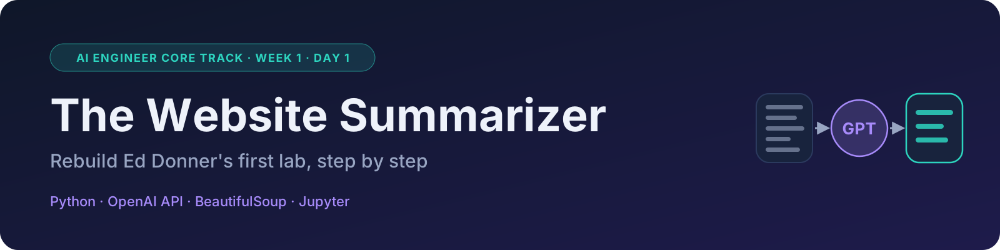

# LLM-Scraper

My exercises for the **AI Engineer Core Track** (Ed Donner's LLM Engineering course).

## Week 1

| File | What's inside |
| --- | --- |
| [week1/day1_en.ipynb](week1/day1_en.ipynb) | Illustrated step-by-step guide to rebuilding the Day 1 lab: a website summarizer powered by GPT |
| [week1/day1.ipynb](week1/day1.ipynb) | The same guide, in Italian |
| [week1/day1_email_subjects.ipynb](week1/day1_email_subjects.ipynb) | My solution to Ed's exercise: paste an email and GPT suggests 3 subject lines plus a one-line summary (Italian) |
| [week1/day1_aviatrix.ipynb](week1/day1_aviatrix.ipynb) | A structured summary of the [docs.aviatrix.com](https://docs.aviatrix.com/) documentation, with a bonus on `llms.txt` (Italian) |
| [week1/scraper.py](week1/scraper.py) | The scraper used by the lab, based on Ed's |

## How to run them

1. Install the libraries: `pip install openai python-dotenv requests beautifulsoup4 ipython`
2. Create a `.env` file in the root folder containing `OPENAI_API_KEY=sk-proj-...`
3. Open a notebook in Cursor, select the `.venv` kernel and run the cells from top to bottom.

The `.env` file is excluded from the repository by `.gitignore`.

Based on Ed Donner's course: [ed-donner/llm_engineering](https://github.com/ed-donner/llm_engineering).
